# Second Chance

Десктопное приложение для центра социальной адаптации: учёт резидентов, комнат,
индивидуальных программ реабилитации (ИПР), мероприятий, склада гуманитарной
помощи и её выдачи, отчёты с выгрузкой в CSV.

**Стек:** Python 3.10+, Tkinter, PostgreSQL 13+, psycopg2, pytest.

## Архитектура

second_chance/
  config.py        настройки БД из окружения / .env
  db.py            соединение, транзакции, перевод ошибок драйвера в понятные
  security.py      хэширование паролей (scrypt)
  validation.py    проверка данных форм (чистые функции)
  services/        вся бизнес-логика и SQL (по модулю на сущность)
  ui/              Tkinter: формы, таблицы, вкладки - без SQL и бизнес-правил
sql/               schema.sql, демо-данные
scripts/init_db.py создание БД, схемы и пользователей
tests/             pytest; БД подменяется поддельной, Tkinter не нужен

Интерфейс вызывает только сервисы; сервисы ничего не знают про Tkinter. Поэтому
логику можно тестировать без графики и без работающего PostgreSQL.

## Запуск

```bash
python -m second_chance
```

`init_db.py` спросит пароли для `admin` и `curator` (или возьмёт из переменных
`SC_ADMIN_PASSWORD`, `SC_CURATOR_PASSWORD`). Без демо-данных: `--no-demo`.
Пересоздать таблицы: `--reset` (удаляет данные, а также позволяет самим установить удобный пароль).

## Роли

| Возможность                              | Администратор | Куратор                |
|------------------------------------------|:-------------:|:----------------------:|
| Резиденты: просмотр                      | все           | только свои            |
| Резиденты: добавить / изменить / удалить | да            | нет                    |
| ИПР и мероприятия: просмотр              | все           | только свои            |
| ИПР и мероприятия: создание, статус      | нет           | да, в своих ИПР        |
| Выдача помощи                            | всем          | только своим резидентам|
| Склад: пополнение, статистика            | да            | нет                    |
| Отчёты и выгрузка в CSV                  | все данные    | только свои данные     |

Куратор привязан к сотруднику через `SystemUsers.curator_id`, поэтому видит
именно своих подопечных, а не данные «куратора №1».

## Тесты

```bash
pip install -r requirements-dev.txt
pytest
```

Проверяются: хэширование паролей, валидация, права доступа, вместимость комнат,
атомарное списание со склада, область видимости куратора, CSV-экспорт.


## Ограничения

- Редактирование ИПР и добавление новых позиций склада пока не реализованы.
- Демо-данные вымышленные.
- Учётные записи создаются скриптом; управления пользователями в интерфейсе нет.

## Скриншоты

### Резиденты и поиск
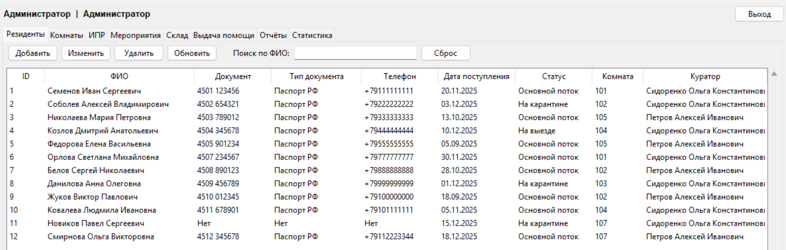

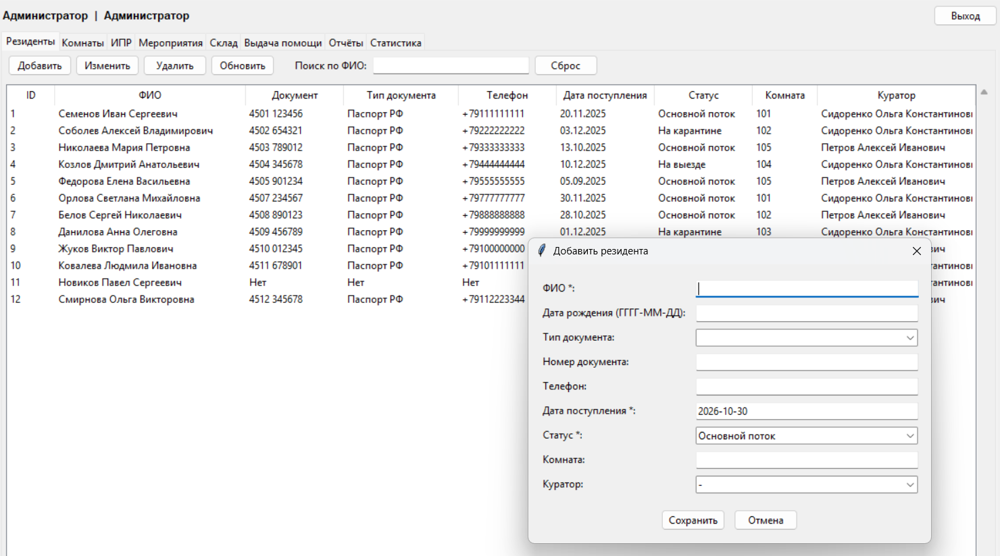

### ИПР и мероприятия
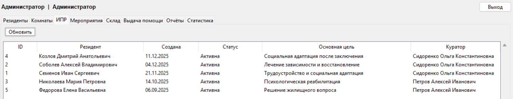

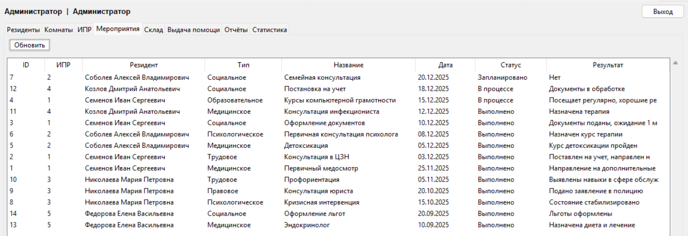

### Склад и выдача помощи
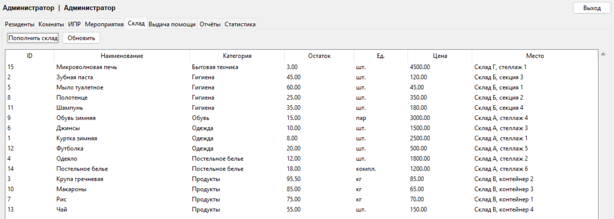

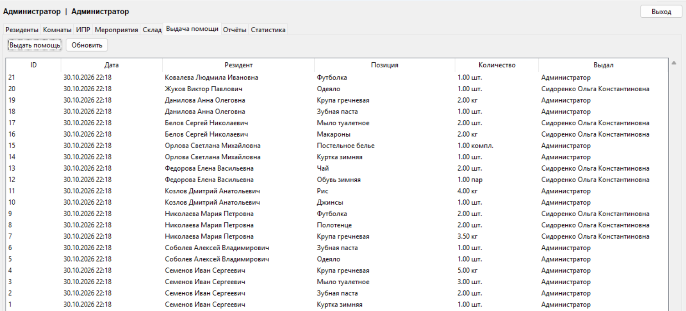

### Отчёты и статистика
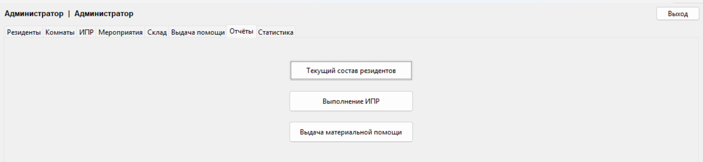

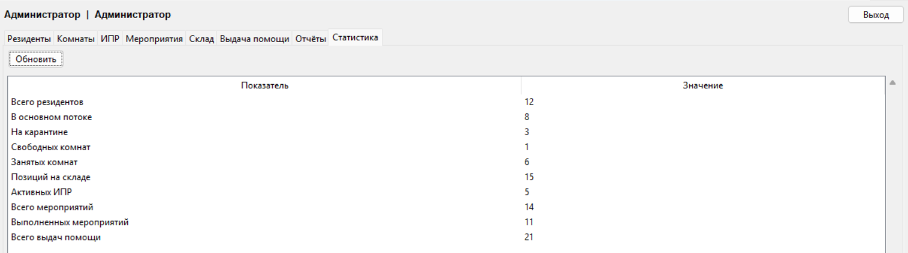

<details>
<summary>Ещё скриншоты: формы, отчёты, CSV</summary>

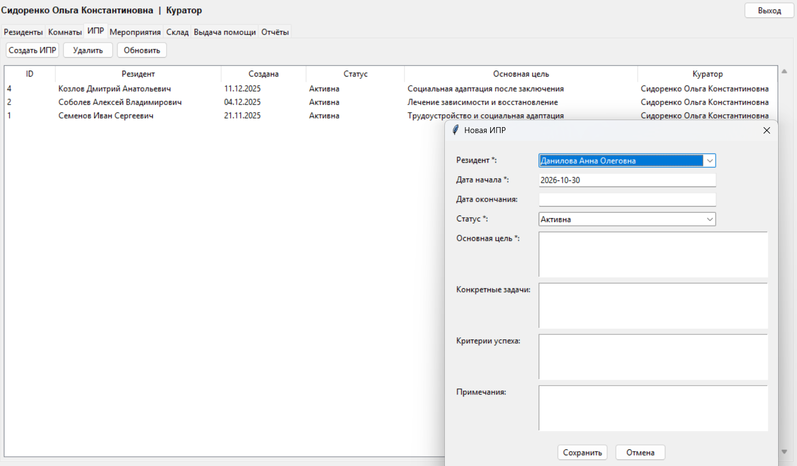
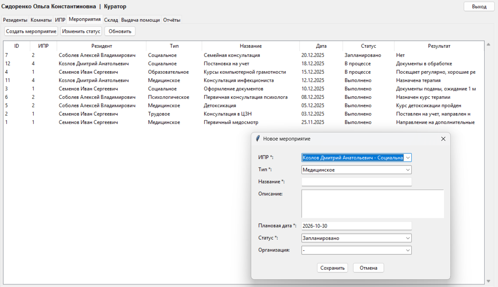
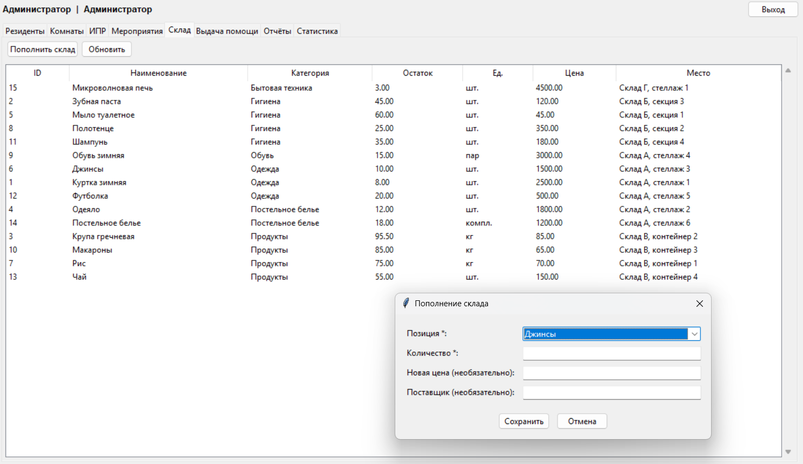
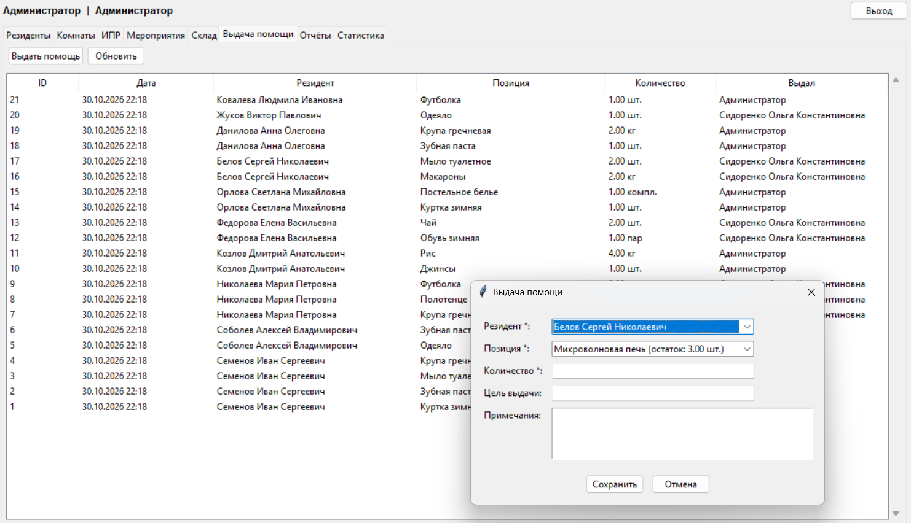
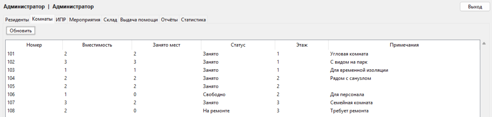
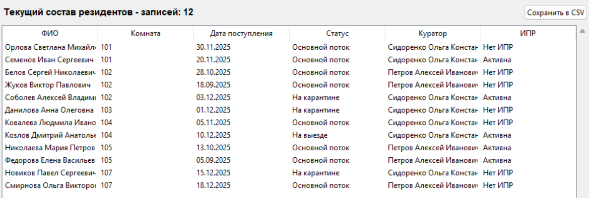
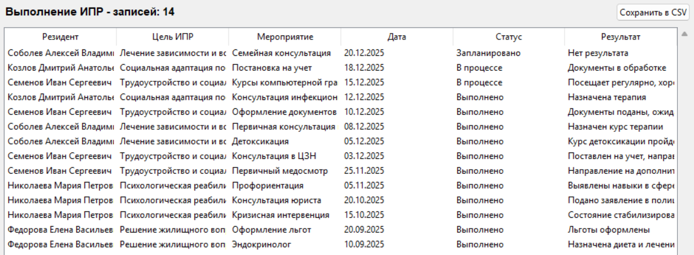
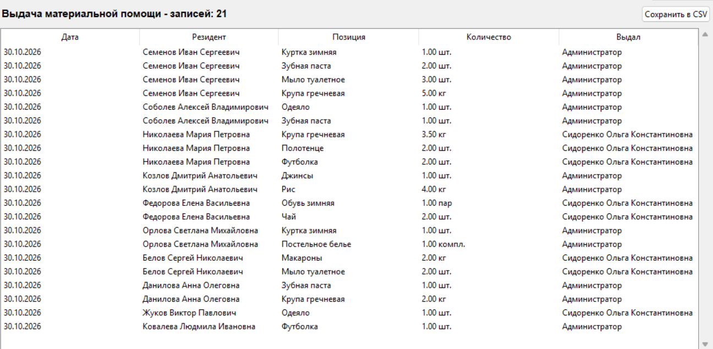
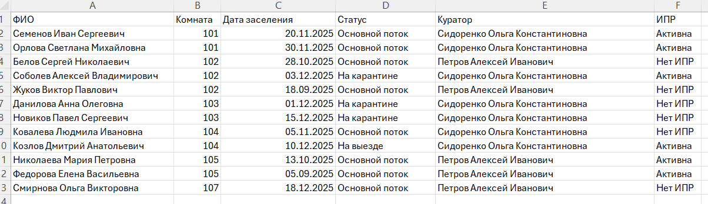

</details>